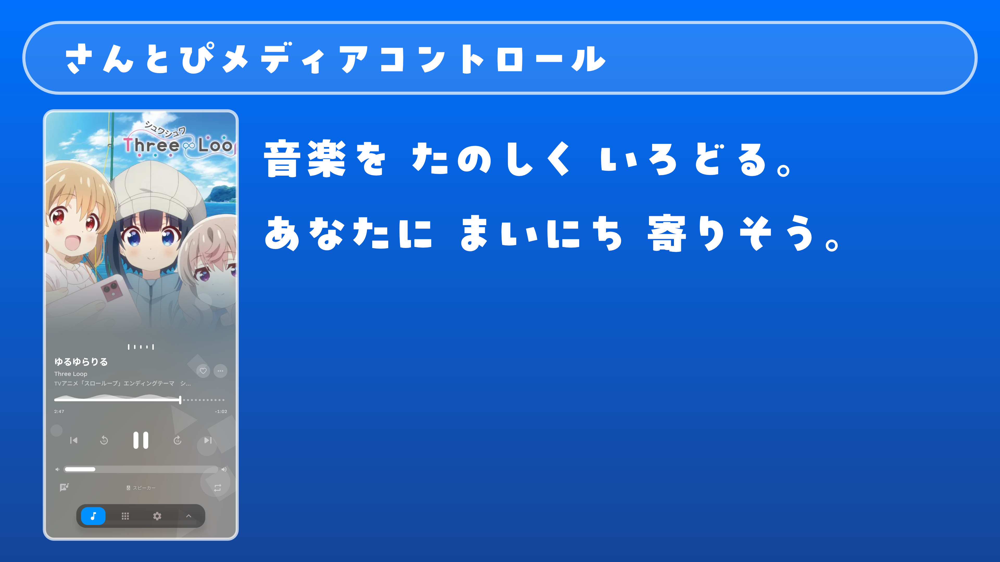
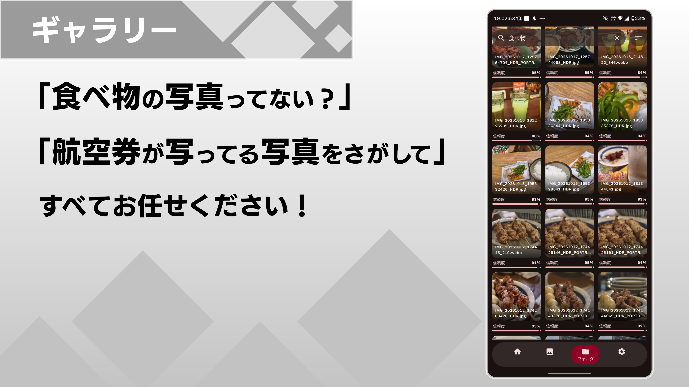
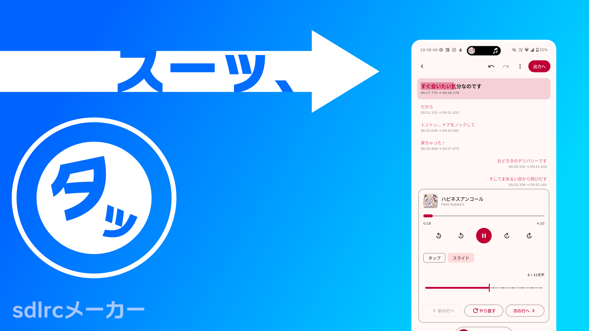

# ようこそ！！
こんにちは。さんどるぴんです。さまざまなAndroidアプリをClaudeと作ります。細かいところまでこだわり、誰が使っても使いやすいアプリを目指しています。

## マイプロフィール
- 高校3年生
- 群馬県在住
- いつもはAffinityでデザインをしたり、動画を作ったり、絵を描いたりなんだりしています。

<table>
<tr>
<td width="50%" valign="top">

**[さんとぴメディアコントロール](https://github.com/sandolpin/SantopimediaControl3.5)**

たくさんの機能がつまったメディアコントロール。

</td>
<td width="50%" valign="top">

**[ギャラリー](https://github.com/sandolpin/Gallery)**

検索方法を、変える。

</td>

</tr>

<tr>
<td width="50%" valign="top">

**[sdlrcメーカー](https://github.com/sandolpin/sdlrcmaker2)**

直感的な操作の歌詞づくり。

</td>

</tr>
</table>

ほかのアプリははリポジトリから

## Contribution Snake
準備中

---

### ビジターカウント

